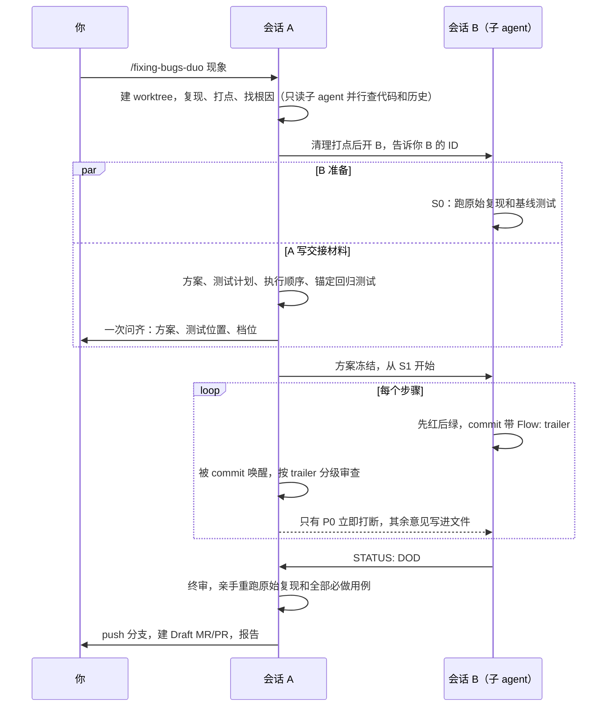

# fixing-bugs-duo

给 AI 编码助手（下文简称 agent）用的修 bug skill，一个 bug 由两个会话分工修：

- 会话 A 诊断根因、写方案和测试计划、审查、验收。你只和 A 对话。
- 会话 B 是 A 在后台开的子 agent。它在独立的 worktree 里按冻结的方案先写失败的测试，再修到通过。

A 盯着 B 的每个 commit 审查。B 遇到歧义，或者同一条测试换了 3 种改法还不通过，就向 A 请求裁决。最后 A 验收、push 分支、建 Draft MR/PR。合入默认由人确认；你明确授权时（例如「MR 能合就合」），A 按项目的合入流程跟到合入。

它建在单会话的 [fixing-bugs](https://github.com/Shengjingwa/fixing-bugs) 之上，两个要一起装。大多数 bug 用 `/fixing-bugs` 就够；修复要分多步提交、碰到关键路径，或者你想让一个会话专门盯着另一个会话干活时，用 `/fixing-bugs-duo`。

简单问题不开 B：快修档，以及诊断后判为豁免的问题（见下文「分档」），A 自己单会话修完，报告里写明为什么没开 B。

## 流程

下图是一次两会话修复的主线。A 和 B 共用一个任务 worktree，但不同时写：A 诊断完清干净，才交给 B。



## 分档

诊断出根因后，A 按执行顺序的步数，以及一轮「原始复现加相关测试」的耗时分档：

| 情况 | 做法 |
|---|---|
| 快修档（日志直接指向代码） | 按 `fixing-bugs` 单会话修完，不建 worktree |
| 没命中硬条件，并且 ≤2 步，或 ≤4 步且一轮不超过 5 分钟 | 豁免：A 在 worktree 里单会话修完，不开 B。3–4 步的，交付前派 1 个审查 agent 复查 |
| 其余没命中硬条件、≤8 步的 | 轻量版：只在最后一步做一次全量审查 |
| >8 步，或命中硬条件 | 全流程：至少每 4 步一个里程碑，每个里程碑做一次全量审查；历史上出过事的判据各写一条锚定断言 |

开 B 有固定开销：A 要写 7 个以上交接文件、起监视脚本、每步审查。步数少、测试又快时，A 自己修更快。B 划算的是测试慢、步骤多，或有活能并行的 bug。

硬条件有三条：需要外部裁决；改动碰到关键路径；改动落在历史上出过 P0/P1 的模块。两档都会锚定第一条正式回归测试：B 只能改它的写法，不能改它的期望值，要改方向必须先向 A 申请。这条规矩防的是最常见的假绿：把回归测试的期望改成迁就现状。

## 现场

| 位置 | 路径 | 谁写 |
|---|---|---|
| 主仓库 | `<父目录>/<repo>` | 不写，只记基线 |
| 任务 worktree | `<父目录>/<repo>-wt-<短名>`，分支 `fix/<短名>`；项目有命名规范时按规范 | A 诊断期间归 A，交接后归 B |
| duo 目录 | 任务 worktree 私有 git 目录下的 `duo/` | B 的进度、日志和长命令标记 |
| flow 仓库 | `<父目录>/<repo>-flow/`，每个 bug 一个子目录 | 只有 A |

worktree 优先从目标分支的上游（例如 `origin/main`）建，主仓库没推送的 commit 和未提交的改动都不会带进 MR/PR，A 也不用去 pull 或清理主仓库。目标分支没有上游时从主仓库的 HEAD 建，这时没推送的 commit 会带进去。

flow 仓库自带 git，放交接材料、裁决记录和审查记录，以及跨任务的登记表 `registry.md`。登记表记关键路径、出过事的模块和门槛判例，下一个 bug 定档时会用到。任务结束后，子目录移进 `archive/`。

duo 目录不在工作区里，`git status` 看不到，也不用改 `.gitignore` 或 `info/exclude`。删 worktree 时它会一起删掉，主仓库不留痕迹。

PR 合入或你宣布放弃后，A 删掉 worktree 和本地分支。放弃时，远端分支和 Draft MR/PR 默认保留，A 会问你要不要删。

## 进度与卡住

A 在对话里每次用一行汇报进度，例如：

```text
[duo csv-missing-row] S2/3 完成 · a1b2c3d · 轻检通过 · 待你拍板：无
```

下面这些事件各汇报一次：B 已开、步骤完成、发现或修好 P0、需要你拍板、B 卡住、步骤超时或出错、最终交付。没有变化时不汇报。你随时问「进度」，A 会先拍一次快照再回答。

A 靠 `scripts/` 里的监视脚本醒来。下面几种情况，脚本都会唤醒 A：
1. B 有需要审查的 commit。
2. B 提出裁决请求。
3. B 疑似卡住。
4. B 一步做得太久：离 B 上一次交出要审查的 commit，或离它这一轮开始，已过了步骤超时，之后每过一个步骤超时再报一次。步骤超时取 30 分钟和 4 倍「一轮测试耗时」中的大者。不传 B 的转录时，脚本不报这一条，由 A 在心跳时自己算。
5. 只在不传 B 的转录时（退回两个独立聊天，或宿主开子 agent 时不给转录路径）：20 分钟没有任何事件。A 收到这个心跳，自己核对 B 是不是卡住了、一步是不是做得太久。

判定卡住要三条同时成立：
1. B 本该在干活。
2. 10 分钟没有动静：它的日志、进度文件、git 提交和改动中的文件都没有更新。B 的转录不算，Cursor 只在 B 一轮结束时才写它。
3. 它没有声明正在跑长命令。B 跑预计超过 2 分钟的命令前，会写一个带预计时长的标记，并把命令放到后台跑。万一误判、A 打断了 B，后台命令照常跑完；前台命令会被取消。

卡住时，A 先自行打断 B 一次。又过 10 分钟（不传转录时是下一次心跳，约 20 分钟）还没动静，就报给你，由你决定是否换一个 B。

B 一直有动静、但一步做得太久时，算步骤超时，不算卡住：B 可能在原地打转，比如反复试同一类改法。同一步第一次超时，A 只看提交和进度、汇报一行，不打扰 B。第二次，A 问你：打断 B、复查计划，还是继续等。你选继续等，下一次超时又只汇报。

A 交付前，按脚本启动时打出的 pid 停掉监视脚本；重启前也先按这个 pid 确认旧脚本已经停了，免得两个脚本同时唤醒 A。万一漏停，worktree 删掉后脚本也会自己退出。

## 用法

```text
/fixing-bugs-duo 每日事件数报表比原始日志少，复现：py -3 -m events.cli data/sample.jsonl
```

也能用来做新功能：现象写成现在缺的行为，复现写成现在会失败的验收命令，根因写成要改的代码位置。一个任务要改几个仓库时，每个仓库单独走一遍，步数少的（例如只改配置）通常由 A 单会话做完。

前提：
1. 仓库是 git 仓库，能建 worktree，git 版本不低于 2.15（要用 `--no-optional-locks`）。
2. 宿主能开后台子 agent，并能给运行中的子 agent 发消息。Cursor 可以，它的子 agent 也能再开子 agent。宿主开子 agent 时不给转录路径的（例如 Claude Code），监视脚本不传转录，靠心跳让 A 自己核对。宿主不支持后台子 agent 时，A 把 B 的启动提示词写进文件，请你新开一个聊天粘贴；A 给 B 的指令写进交接文件，由你在 B 的聊天里发一句「继续」。B 在这种方式下卡住时，A 会请你先停掉 B 当前这一轮再发「继续」；还不动，再请你停掉它，新开一个聊天接手。
3. 宿主能用后台命令的输出唤醒 agent，例如 Cursor Shell 的 `notify_on_output`。
4. B 的 commit 会进 MR/PR，要用真实的 git 身份。仓库没有配置 `user.name` 和 `user.email` 时，A 会在确认方案时一起问你用哪个身份，不会自己编一个。
5. 平台：在 Windows + Cursor 上试跑过。Windows 上监视脚本用 `scripts/watch.ps1`，Windows 自带的 PowerShell 5.1 和 PowerShell 7 都能跑。`scripts/watch.sh` 给 Linux 和 macOS 用，CI 在 Ubuntu 上跑它的测试，macOS 没有测过。

A 会自己判断改动有没有碰到关键路径、是不是落在出过事的模块里，拿不准时才问你。你的答复记进 `registry.md`，同一个仓库下次不再问。

# 安装

`fixing-bugs-duo` 要读同一个 skill 目录下的 `fixing-bugs`，两个仓库都要装。

## 方式 1：用 skills CLI 安装

```bash
npx skills add Shengjingwa/fixing-bugs
npx skills add Shengjingwa/fixing-bugs-duo
```

## 方式 2：手动复制

把两个仓库 `skills/` 下的目录整个复制到对应工具的 skill 目录：

- **Cursor**：`~/.cursor/skills/`（Windows 是 `%USERPROFILE%\.cursor\skills\`）
- **Claude Code**：`~/.claude/skills/`
- **Codex**：`~/.codex/skills/`

复制完应该是 `<skill 目录>/fixing-bugs/` 和 `<skill 目录>/fixing-bugs-duo/` 并列。

注意：
1. 目录名必须和 `SKILL.md` 里的 `name` 一致，即 `fixing-bugs-duo`。
2. 整个目录一起复制：`fixing-bugs-duo/` 里有 `SKILL.md`、`supervise.md`、`b.md`、`review.md`、`files.md` 和 `scripts/`。快修只读 `SKILL.md`；豁免还会读 `review.md`，你授权合入时再读 `supervise.md` 的「跟到合入」；开了 B 之后，A 才读 `supervise.md` 和 `review.md`，B 只读 `b.md`。
3. 在 Cloud Agent 或远程容器里用时，把两个目录放到仓库根目录下的 `.cursor/skills/`。
4. Cursor 和 Claude Code 读 `SKILL.md` 里的 `disable-model-invocation: true`，只在你输入 `/fixing-bugs-duo` 时调用。

# 前置依赖

- [`fixing-bugs`](https://github.com/Shengjingwa/fixing-bugs)：A 用它的开头、快修和完整档第 1–4 段，B 用完整档第 5–6 段。
- `diagnosing-bugs`、`tdd`：来自 [mattpocock/skills](https://github.com/mattpocock/skills) 的 `skills/engineering/` 目录。A 诊断时用 `diagnosing-bugs`，B 写测试时用 `tdd`。

# 测试

`tests/` 里是两个监视脚本的测试。每个场景建一个一次性的 git worktree，场景并行跑，每个脚本约 2 分钟：

```text
pwsh -NoProfile -ExecutionPolicy Bypass -File tests/test-watch.ps1
powershell -NoProfile -ExecutionPolicy Bypass -File tests/test-watch.ps1
bash tests/test-watch.sh
```

前两行分别测 PowerShell 7 和 Windows PowerShell 5.1。GitHub Actions 在 Windows 上跑前两行，在 Ubuntu 上跑第三行。

# 许可证

本项目采用 [MIT License](LICENSE) 授权。
